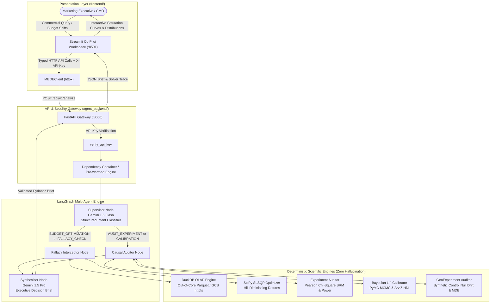

# Marketing Econometrics & Decision Engine (MEDE)

[](https://www.python.org/)
[](https://fastapi.tiangolo.com)
[](https://streamlit.io)
[](https://duckdb.org)
[](https://www.pymc.io)
[](https://github.com/langchain-ai/langgraph)
[](LICENSE)

**MEDE** is an enterprise-grade autonomous econometric guardrail and capital allocation platform designed for Tier-1 FMCG marketing leadership (e.g., Procter & Gamble, Unilever, L'Oréal).

Built by an AI Engineer and Marketing Scientist, MEDE solves the critical failure mode of enterprise generative AI: **Zero Hallucinated Arithmetic**. Large Language Models never compute mathematical, statistical, or financial operations. Instead, LLMs strictly classify commercial intent and synthesize deterministic, mathematically proven outputs into executive decision briefs.

---

## 🏛️ Executive Summary & Problem Statement

Tier-1 brands misallocate tens of millions of euros annually due to four recurrent commercial cognitive fallacies:

1. **Average vs. Marginal ROAS Confusion:** Scaling spend in channels with high historical average ROAS ($aROAS$), unaware that marginal efficiency ($mROAS$) is deeply saturated ($< 1.0$).
2. **Adstock & Decay Blindness:** Pausing advertising and falsely attributing short-term revenue stability to "channel redundancy," ignoring geometric and Weibull carryover decay.
3. **Premature A/B Stopping & SRM:** Making multi-million euro decisions on experiments compromised by Sample Ratio Mismatch (SRM) or severe statistical underpowering ($< 80\%$).
4. **Uncalibrated Observational MMM:** Relying purely on observational regression models confounded by unobserved trend and seasonality without grounding priors in randomized experimental incrementality (GeoLift / causal holdouts).

MEDE pairs an autonomous **LangGraph multi-agent cognitive architecture** with high-performance **DuckDB OLAP**, **SciPy SLSQP non-linear optimizers**, and **PyMC Bayesian MCMC sampling** to police and optimize every capital decision.

---

## 🔄 End-to-End System Architecture



---

## 📂 Repository Topology

```text
senior_marketing_scientist/
├── README.md                      # Master Platform Overview (You are here)
├── LICENSE                        # MIT License
├── .github/
│   └── workflows/
│       ├── ci.yml                 # Lint, Mypy, Pytest & Docker Build Pipeline
│       └── eval.yml               # 20-Scenario Econometric Accuracy Benchmark
├── agent_backend/                 # Core FastAPI, LangGraph & Deterministic Engines
│   ├── README.md                  # Backend Technical Documentation
│   ├── pyproject.toml             # Backend dependencies & tool configs
│   ├── .env.example               # Environment template
│   ├── data/
│   │   ├── raw/
│   │   └── gold/                  # Out-of-core Parquet gold dataset
│   ├── docker/
│   │   ├── Dockerfile             # Multi-stage production container
│   │   ├── docker-compose.yml     # Full stack (API, Frontend, Prometheus, Langfuse)
│   │   └── prometheus.yml         # Prometheus scraping config
│   ├── evaluations/
│   │   ├── test_cases.json        # 20 Tier-1 FMCG benchmark scenarios
│   │   └── run_evals.py           # Evaluation runner
│   ├── scripts/
│   └── src/
│       ├── api/                   # FastAPI routes, schemas, and dependencies
│       ├── agents/                # LangGraph nodes (Supervisor, Interceptor, Auditor, Synthesizer)
│       ├── core/                  # Configuration & Prometheus/Langfuse telemetry
│       └── tools/                 # DuckDB, SciPy SLSQP, PyMC & Experimentation engines
│   └── tests/                     # 42 unit and integration tests
├── frontend/                      # Streamlit Co-Pilot Workspace & Interactive Diagnostics
│   ├── README.md                  # Frontend Architecture & Setup Guide
│   ├── Dockerfile                 # Production Streamlit container
│   ├── requirements.txt           # Frontend dependencies
│   ├── app.py                     # Split-screen Co-Pilot entrypoint
│   ├── client.py                  # Typed HTTP client communicating with backend
│   ├── components/                # Modular UI widgets (forms, Plotly charts, chat, trace)
│   └── tests/                     # UI and client unit tests
├── orchestration/                 # Data Pipeline Orchestration
│   ├── requirements.txt           # Prefect dependencies
│   └── weekly_ingestion_dag.py    # Automated weekly spend ingestion to GCS
└── terraform/                     # Infrastructure as Code (GCP)
    ├── main.tf                    # Cloud Run, GCS, Secret Manager, Artifact Registry
    ├── variables.tf               # GCP project, region, and container specs
    └── outputs.tf                 # Service URLs
```

---

## ⚡ Quickstart

### Option 1: One-Command Full Stack (Docker Compose)

Launch the entire ecosystem (FastAPI Backend, Streamlit Frontend, Prometheus Metrics):

```bash
# 1. Clone the repository
git clone https://github.com/Moritz-Binder/marketing_scientist_agent.git
cd marketing_scientist_agent

# 2. Configure Backend Environment
cp agent_backend/.env.example agent_backend/.env
# Edit agent_backend/.env and populate GEMINI_API_KEY="your-gemini-api-key"

# 3. Launch with Docker Compose
docker compose -f agent_backend/docker/docker-compose.yml up --build -d
```

Services will be immediately accessible:

* **Interactive Frontend (Streamlit):** [http://localhost:8501](http://localhost:8501)
* **API Documentation (Swagger UI):** [http://localhost:8000/docs](http://localhost:8000/docs)
* **Prometheus Metrics:** [http://localhost:9091](http://localhost:9091) (scraped from `:9090`)
* **Health Check:** `curl http://localhost:8000/health`

---

### Option 2: Local Development Setup

#### 1. Backend Setup

```bash
cd agent_backend

# Create virtual environment and install dependencies
python3.11 -m venv .venv
source .venv/bin/activate
pip install -e .[dev]

# Generate synthetic 156-week gold Parquet data
python scripts/generate_synthetic_data.py

# Configure environment variables
cp .env.example .env
# Set GEMINI_API_KEY in .env

# Run FastAPI backend
uvicorn src.api.main:app --host 0.0.0.0 --port 8000 --reload
```

#### 2. Frontend Setup

In a new terminal:

```bash
cd frontend

# Install frontend requirements
pip install -r requirements.txt

# Configure environment
cp .env.example .env
# Default: API_BASE_URL="http://localhost:8000/api/v1"

# Run Streamlit Co-Pilot Workspace
streamlit run app.py --server.port 8501
```

---

## 📐 Mathematical & Econometric Formulations

MEDE implements deterministic econometric formulations in compiled C/Fortran libraries (`numpy`, `scipy`, `duckdb`, `pymc`):

### 1. Adstock Transformations

Media carryover effects are modeled through geometric decay and continuous Weibull distributions:

$$\text{Geometric Adstock: } x_{\text{adstocked}}(t) = x(t) + \alpha \cdot x_{\text{adstocked}}(t-1)$$

$$\text{Weibull PDF: } f(t; k, \lambda) = \frac{k}{\lambda}\left(\frac{t}{\lambda}\right)^{k-1} e^{-(t/\lambda)^k}, \quad w_t = \frac{f(t)}{\sum_{\tau=0}^{L} f(\tau)}$$

$$\text{Weibull CDF: } F(t; k, \lambda) = 1 - e^{-(t/\lambda)^k}, \quad w_t = F(t) - F(t-1)$$

### 2. Hill Saturation Function

Diminishing marginal returns are modeled using the Hill kinetic equation:

$$\text{Revenue}(S) = \frac{V_{\max} \cdot S^n}{K^n + S^n}$$

$$\text{Marginal ROAS: } \frac{dR}{dS} = \frac{V_{\max} \cdot n \cdot K^n \cdot S^{n-1}}{(K^n + S^n)^2}$$

$$\text{Average ROAS: } aROAS = \frac{\text{Revenue}(S)}{S}$$

*Inflection Point ($K$):* When spend $S = K$, revenue reaches exactly $50\%$ of saturation capacity ($V_{\max}/2$).

### 3. Non-Linear Budget Optimization (SLSQP)

Budget reallocation solves the constrained non-linear program:

$$\max_{\vec{S}} \sum_{i=1}^{M} R_i(S_i) \iff \min_{\vec{S}} -\sum_{i=1}^{M} \frac{V_{\max, i} \cdot S_i^{n_i}}{K_i^{n_i} + S_i^{n_i}}$$

$$\text{Subject to: } \sum_{i=1}^{M} S_i = B_{\text{total}}, \quad L_i \le S_i \le U_i \quad \forall i \in \{1, \dots, M\}$$

Solved deterministically via Sequential Least Squares Programming (`scipy.optimize.minimize(method="SLSQP")`).

### 4. Sample Ratio Mismatch (SRM) & Power Audit

* **Pearson Chi-Square Goodness-of-Fit:** Tests observed vs. expected traffic ratio:

$$\chi^2 = \sum_{i \in \{C, V\}} \frac{(O_i - E_i)^2}{E_i}, \quad p = 1 - F_{\chi^2_1}(\chi^2)$$

* **Statistical Power for Two-Sample Proportion Z-Test:**

$$\text{Power} = \Phi\left(\frac{\vert{}\Delta\vert{} - Z_{1-\alpha/2}\sqrt{2\bar{p}(1-\bar{p})/\bar{n}}}{\sqrt{p_1(1-p_1)/\bar{n} + p_2(1-p_2)/\bar{n}}}\right)$$

### 5. Bayesian MMM Prior Calibration (MCMC)

Updates uncalibrated observational MMM prior estimates $\beta_{\text{channel}} \sim \mathcal{N}(\mu_{\text{prior}}, \sigma^2_{\text{prior}})$ with randomized causal experiment results (GeoLift):

$$\text{PyMC Formulation: } \beta \sim \mathcal{N}(\mu_{\text{prior}}, \sigma_{\text{prior}}), \quad y_{\text{obs}} \sim \mathcal{N}(\beta, \sigma_{\text{lift}})$$

Sampled via NUTS / MCMC producing 95% High Density Intervals (HDI) and shrinkage diagnostics.

---

## 🖥️ Platform Modules

| Module | Description | Location | Documentation |
| :--- | :--- | :--- | :--- |
| **Agent Backend** | FastAPI service, LangGraph agent workflows, DuckDB OLAP, SciPy SLSQP, PyMC MCMC | [`agent_backend/`](file:///Users/moe/Developer/github.com/Moritz-Binder/marketing_scientist_agent/agent_backend) | [Backend README](file:///Users/moe/Developer/github.com/Moritz-Binder/marketing_scientist_agent/agent_backend/README.md) |
| **Frontend Co-Pilot** | Streamlit split-screen UI, interactive forms, and Plotly saturation/allocation diagnostics | [`frontend/`](file:///Users/moe/Developer/github.com/Moritz-Binder/marketing_scientist_agent/frontend) | [Frontend README](file:///Users/moe/Developer/github.com/Moritz-Binder/marketing_scientist_agent/frontend/README.md) |
| **Data Ingestion** | Prefect ingestion pipeline simulating and syncing weekly FMCG media spend to Cloud Storage | [`orchestration/`](file:///Users/moe/Developer/github.com/Moritz-Binder/marketing_scientist_agent/orchestration) | [`orchestration/weekly_ingestion_dag.py`](file:///Users/moe/Developer/github.com/Moritz-Binder/marketing_scientist_agent/orchestration/weekly_ingestion_dag.py) |
| **Cloud Infrastructure** | Terraform IaC for GCP Cloud Run, Secret Manager, Cloud Storage, and Artifact Registry | [`terraform/`](file:///Users/moe/Developer/github.com/Moritz-Binder/marketing_scientist_agent/terraform) | [`terraform/main.tf`](file:///Users/moe/Developer/github.com/Moritz-Binder/marketing_scientist_agent/terraform/main.tf) |
| **Evaluations** | 20 benchmark scenarios testing fallacy detection accuracy, SRM recall, and zero hallucination | [`agent_backend/evaluations/`](file:///Users/moe/Developer/github.com/Moritz-Binder/marketing_scientist_agent/agent_backend/evaluations) | [`evaluations/run_evals.py`](file:///Users/moe/Developer/github.com/Moritz-Binder/marketing_scientist_agent/agent_backend/evaluations/run_evals.py) |

---

## 🧪 Testing & Validation

The platform includes a comprehensive test suite covering mathematical invariants, API contracts, and graph routing:

```bash
# Run Backend Unit & Integration Tests (42 tests)
cd agent_backend
PYTHONPATH=. .venv/bin/pytest tests -v

# Run Frontend Component & Client Tests (7 tests)
cd ../frontend
PYTHONPATH=.. ../agent_backend/.venv/bin/pytest tests -v

# Run 20-Scenario Benchmark Evaluations (Requires Gemini API Key)
cd ../agent_backend
python evaluations/run_evals.py
```

---

## 🔒 Security, Telemetry & Enterprise Governance

* **Authentication:** All API endpoints are protected with strict API Key enforcement via `X-API-Key` headers.
* **Telemetry & Metrics:** Native Prometheus integration exposing `/metrics` on port `9090` (and `9091` in Docker Compose).
* **Distributed Tracing:** Langfuse and OpenTelemetry integration for complete lineage tracking of LangGraph state transitions and LLM prompts.
* **Infrastructure as Code:** Declarative GCP Cloud Run deployments with least-privilege service accounts and Secret Manager integration.

---

## 📄 License

This project is licensed under the MIT License - see the [LICENSE](file:///Users/moe/Developer/github.com/Moritz-Binder/marketing_scientist_agent/LICENSE) file for details.
